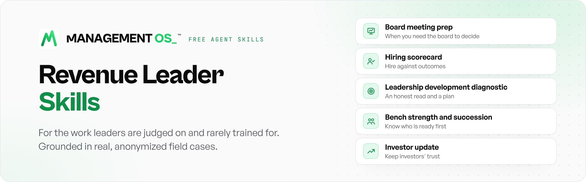

<picture>
  <source media="(prefers-color-scheme: dark)" srcset="docs/images/banner-dark.png">
  
</picture>

<p align="center">
  <a href="#the-five-skills"></a>
  <a href="#quick-install"></a>
  <a href="#a-look-inside-the-ship-check"></a>
  <a href="LICENSE"></a>
</p>

Five agent skills for the work revenue leaders are judged on and rarely trained for: running the board, hiring, developing leaders, building the bench, and keeping investors' trust. Each one turns a judgment call into a method, and ships with a rubric that tells you when the work is ready. These skills share a foundation within the Management OS sales management operating system.

By [Jason Mesiarik](https://www.linkedin.com/in/jasonmesiarik), founder and CEO of [Management OS](https://mgmt-os.ai?utm_source=github&utm_medium=readme&utm_campaign=revenue-leader-skills). Each skill is grounded in real situations, with names and details changed.

## Quick install

**Any agent** (Claude Code, Codex, Cursor, Gemini CLI, GitHub Copilot and more):

```
npx skills add Management-OS-Inc/revenue-leader-skills
```

It finds the agents you have installed and asks which skills to add. Add `--skill investor-update` to take just one.

**Claude (web and desktop):** download a skill folder, zip it, then go to Settings > Capabilities > Skills > **Upload skill**. Works on Pro, Max, Team and Enterprise with code execution turned on.

**By hand:** copy any folder from `skills/` into your agent's skills directory. No agent? Read any `SKILL.md` as a playbook.

## The five skills

| Skill | Use it when | Try asking |
|---|---|---|
| [Board meeting prep](skills/board-meeting-prep/SKILL.md) | You need the board to decide something | "Prep my Q3 board meeting. I need approval to move budget into pipeline generation." |
| [Hiring scorecard](skills/hiring-scorecard/SKILL.md) | A miss would cost more than three times the salary | "Build a scorecard and interview kit for our first enterprise account executive." |
| [Leadership development diagnostic](skills/leadership-development-diagnostic/SKILL.md) | A leader needs an honest read and a plan | "Give me an honest read on my new sales manager and a 90-day development plan." |
| [Bench strength and succession](skills/bench-strength-and-succession/SKILL.md) | You need to know who is ready before a seat opens | "Who could step into each of my managers' roles in the next year, and what would get them ready?" |
| [Investor update](skills/investor-update/SKILL.md) | You write to investors, boards, or advisors | "Draft this month's investor update from these numbers and notes." |

## What each one produces

<details>
<summary><b>Board meeting prep</b>: a pre-read the board can decide from</summary>
<br>

- A decision-first pre-read
- An in-room agenda budgeted for discussion, not presentation
- One primary ask, framed as a decision brief
- A Q&A and director preparation brief

**Ship bar:** 90 of 100, no criterion below 7. Below 70, rebuild from the decision.

</details>

<details>
<summary><b>Hiring scorecard</b>: a hire you can defend a year from now</summary>
<br>

- An outcome-based scorecard
- A behavioral interview kit
- A reference-check plan
- A decision package with a logged decision, framed by how reversible it is

**Ship bar:** one-way-door hires (co-founder, C-suite, first leader of a function) at 90 with every criterion at 9 or above. Two-way-door hires at 75.

</details>

<details>
<summary><b>Leadership development diagnostic</b>: an honest read the leader can hear</summary>
<br>

- A check of the system before the person
- Where the leader's time actually goes, against what their stage needs
- 360 feedback, direct observation and a live practice test, combined
- A readiness verdict and a 90-day development sprint

**Ship bar:** 90 of 100, no criterion below 7.

</details>

<details>
<summary><b>Bench strength and succession</b>: know who is ready before a seat opens</summary>
<br>

- A critical-role bench scorecard, with single points of failure named
- An evidence-based performance and potential map
- A readiness call for every successor
- Emergency coverage plans
- A talent review run with bias controls

**Ship bar:** 90 of 100, no criterion below 7.

</details>

<details>
<summary><b>Investor update</b>: each update, a deposit in the record of your word</summary>
<br>

- One headline, up front
- A consistent metrics frame, update after update
- Wins, risks and specific asks
- An honesty check before it ships

**Ship bar:** 90 of 100, no criterion below 7.

</details>

## A look inside: the ship check

Every skill ends with a ten-criterion rubric, scored before anything is sent. Four of the ten criteria for a board pre-read:

| Criterion | 10 | 7 | 4 |
|---|---|---|---|
| Decision clarity | One primary decision on the cover, stated as a five-link brief, staying the course included as an alternative | Decision clear but one link weak | Topic named, no decision |
| Altitude | Every governing message is a company-level claim | One functional claim remains | Reads as a functional report |
| Room design | Plan at 25:75 or better; opening states the ask in 2 minutes | Plan at 35:65 | Presentation-heavy agenda |
| Director preparation | 15+ data-driven questions; every director pre-briefed with a lens-specific note | 10 to 14 questions; most directors briefed | Generic questions; no pre-briefs |

Full rubric: [package-rubric.md](skills/board-meeting-prep/references/package-rubric.md).

## What makes these different

- **Real situations, not theory.** Each skill teaches through cases: the hire who interviewed worse and performed better, the executive whose success did not transfer, the updates that became the diligence file.
- **Evidence over impressions.** Every rating, readiness call, and claim must cite what was observed.
- **Thresholds, not adjectives.** Pre-read timing, presentation-to-discussion ratios, leadership time allocation by stage, and a ship bar on every rubric.
- **Built to work together.** The same ideas run through all five: answer at company altitude; measure activity, leading indicators, and outcomes separately; look for learning speed and follow-through, not polish.

## On live deals

These skills cover the leader's own work. For the deals and the people in your pipeline, the [Management OS plugin](https://github.com/Management-OS-Inc/management-os-plugin) brings evidence-cited deal reads and rep coaching into Claude, Grok, Gemini and other assistants. [Try it on a sample deal](https://github.com/Management-OS-Inc/management-os-plugin#try-it-on-a-sample-deal).

## Feedback and field cases

Open an issue to report a problem, suggest an improvement, or share an anonymized field case. Issues are public the moment you submit them, so leave out names, companies and anything that identifies a person. Pull requests are not accepted; Management OS maintains the skills to keep them consistent. See [CONTRIBUTING](CONTRIBUTING.md).

## License

MIT, copyright Management OS Inc. See [LICENSE](LICENSE). If you use these in research, training, or published work, see [CITATION.cff](CITATION.cff).
